# PROMPT — Validador de Formato de Correo Institucional UNI (AFD + GUI en Java)

> **Cómo usar este documento:** todo lo que sigue a partir de la línea "## 0. Rol" es el prompt. Cópialo y pégalo completo en un agente de código (Cursor, Claude Code, GitHub Copilot Chat, Codex, etc.). Está escrito como una especificación técnica cerrada: no requiere aclaraciones adicionales para producir un sistema compilable, verificable y defendible académicamente.

---

## 0. Rol

Actúas como **ingeniero de software senior especializado en teoría de autómatas y en aplicaciones de escritorio Java**. Tu tarea es diseñar, implementar y documentar una aplicación de escritorio completa, correcta y ejecutable que valide correos institucionales de la Universidad Nacional de Ingeniería (UNI) mediante un **Autómata Finito Determinista (AFD) formal**, implementado explícitamente en Java —no mediante expresiones regulares ni librerías de validación de correo.

Prioriza en este orden: **(1) corrección formal del autómata**, **(2) claridad y trazabilidad del código**, **(3) calidad de la interfaz**, **(4) estética**. Si algo de esta especificación es ambiguo, resuélvelo del modo más estricto y documenta la decisión en el `README.md`.

---

## 1. Contexto

La UNI desea automatizar la verificación de los correos institucionales de sus estudiantes para tres sistemas: **plataforma virtual**, **biblioteca digital** y **red interna**. Todos los correos institucionales siguen la estructura:

```
<iniciales><número>@uni.edu.ni
```

donde:

| Componente | Regla |
|---|---|
| `<iniciales>` | Entre **2 y 4** letras **minúsculas** (`a`–`z`) |
| `<número>` | Entre **2 y 3** dígitos (`0`–`9`) |
| Dominio | Exactamente `@uni.edu.ni`, en minúsculas, sin variaciones |

**Ejemplos válidos:** `js25@uni.edu.ni`, `lmra123@uni.edu.ni`
**Ejemplos inválidos:** `Js25@unicomp.edu` (mayúscula no permitida), `j@unicomp.edu` (falta número), `js25@unicom.edu` (dominio mal escrito), `abc123@gmail.com` (dominio incorrecto).

### 1.1 Objetivo del producto

Una aplicación de escritorio en **Java** que reciba una cadena, la procese carácter por carácter con el AFD y muestre de forma inequívoca **“ACEPTADO”** o **“RECHAZADO”**, junto con la **traza completa de ejecución** (secuencia de estados recorrida) en una tabla en la parte inferior de la ventana.

### 1.2 Fuera de alcance (no implementar)

- Envío de correos ni verificación de existencia real del buzón (DNS/SMTP).
- Persistencia en base de datos o servicios en red.
- Mayúsculas válidas, caracteres Unicode, `+`, `_`, subdominios o alias.
- Normalización de la entrada (ver §4.4, regla estricta).

---

## 2. Especificación formal del AFD

### 2.1 Alfabeto

```
Σ = { a, b, c, …, z }  ∪  { 0, 1, …, 9 }  ∪  { '@', '.' }
```

- `|Σ| = 38` (26 letras minúsculas + 10 dígitos + 2 símbolos).
- **Corrección explícita:** la definición original del enunciado enlistaba de nuevo `e, d, u, n, i, c, o, m, p` y omitía la llave de cierre; eso es un error de notación. Esas letras **ya pertenecen** a `a–z` y no se duplican en el alfabeto. Documenta esta corrección en el `README.md`.
- Todo carácter **fuera de Σ** (mayúsculas, acentos, espacios, `-`, `_`, `+`, saltos de línea, etc.) **no** produce transición válida: lleva directamente al estado de rechazo y el validador lo reporta como **símbolo fuera del alfabeto**, indicando posición y carácter.

### 2.2 Tupla del autómata

```
M = (Q, Σ, δ, q0, F)

Q  = { q0, q1, …, q18, q19 }              (20 estados)
Σ  = { a–z, 0–9, @, . }                   (38 símbolos)
q0 = q0                                    (estado inicial)
F  = { q18 }                               (único estado de aceptación)
δ  : Q × Σ → Q                             (función total: 20 × 38 = 760 transiciones definidas)
```

### 2.3 Significado de los estados

| Estado | Significado | ¿Final? |
|---|---|---|
| `q0` | Sin leer caracteres (estado inicial) | No |
| `q1` | 1 letra leída (iniciales incompletas) | No |
| `q2` | 2 letras leídas (iniciales válidas, admite dígito) | No |
| `q3` | 3 letras leídas (iniciales válidas, admite dígito) | No |
| `q4` | 4 letras leídas (iniciales en su límite máximo) | No |
| `q5` | 1 dígito leído (parte numérica incompleta) | No |
| `q6` | 2 dígitos leídos (número válido; admite `@`) | No |
| `q7` | 3 dígitos leídos (número en su límite máximo) | No |
| `q8` | Se leyó `@` | No |
| `q9` | `@u` | No |
| `q10` | `@un` | No |
| `q11` | `@uni` | No |
| `q12` | `@uni.` | No |
| `q13` | `@uni.e` | No |
| `q14` | `@uni.ed` | No |
| `q15` | `@uni.edu` | No |
| `q16` | `@uni.edu.` | No |
| `q17` | `@uni.edu.n` | No |
| `q18` | `@uni.edu.ni` completo — **ACEPTACIÓN** | **Sí** |
| `q19` | Estado trampa / sumidero de rechazo | No |

### 2.4 Función de transición δ

**Parte A — iniciales y número (transiciones por clase de símbolo).**
Columnas: `L` = cualquier letra `a–z`, `D` = cualquier dígito `0–9`, `@`, `.`, `otro` = cualquier símbolo restante de Σ.

| Estado | `L` (a–z) | `D` (0–9) | `@` | `.` | otro |
|---|---|---|---|---|---|
| `q0` | `q1` | `q19` | `q19` | `q19` | `q19` |
| `q1` | `q2` | `q19` | `q19` | `q19` | `q19` |
| `q2` | `q3` | `q5` | `q19` | `q19` | `q19` |
| `q3` | `q4` | `q5` | `q19` | `q19` | `q19` |
| `q4` | `q19` | `q5` | `q19` | `q19` | `q19` |
| `q5` | `q19` | `q6` | `q19` | `q19` | `q19` |
| `q6` | `q19` | `q7` | `q8` | `q19` | `q19` |
| `q7` | `q19` | `q19` | `q8` | `q19` | `q19` |

**Parte B — dominio `@uni.edu.ni` (transición por carácter exacto).**
En cada uno de estos estados, **cualquier** símbolo distinto del indicado va a `q19`.

| Estado | Carácter esperado | Siguiente estado |
|---|---|---|
| `q8` | `u` | `q9` |
| `q9` | `n` | `q10` |
| `q10` | `i` | `q11` |
| `q11` | `.` | `q12` |
| `q12` | `e` | `q13` |
| `q13` | `d` | `q14` |
| `q14` | `u` | `q15` |
| `q15` | `.` | `q16` |
| `q16` | `n` | `q17` |
| `q17` | `i` | `q18` |

**Parte C — estados absorbentes.**

| Estado | Todo símbolo de Σ |
|---|---|
| `q18` | `q19` (no se admiten caracteres extra después de `.ni`) |
| `q19` | `q19` (sumidero) |

### 2.5 Invariantes que la implementación debe garantizar

1. **Determinismo total:** para cada par `(q, s) ∈ Q × Σ` existe **exactamente una** transición. No hay transiciones indefinidas ni ε-transiciones.
2. **Aceptación estricta al final:** una cadena se acepta **si y solo si** el último carácter consume la cadena y el estado alcanzado es `q18`. Está **prohibido** aceptar si `q18` se alcanza a mitad de la cadena (p. ej. `js25@uni.edu.ni.mx` debe **rechazarse**).
3. **Cadena vacía:** se rechaza en `q0` (no es estado final); el resultado debe ser `RECHAZADO` con motivo `CADENA_VACIA`, sin excepción.
4. **Equivalencia de referencia (solo para pruebas):** `δ` reconoce exactamente el lenguaje
   `L(M) = { w ∈ Σ* | w ∈ [a-z]{2,4} [0-9]{2,3} "@uni.edu.ni" }`, equivalente a la expresión `^[a-z]{2,4}[0-9]{2,3}@uni\.edu\.ni$`. Esta expresión **solo** puede usarse en los tests como verificación cruzada (property-based testing); **nunca** en la ruta de validación de la aplicación.

---

## 3. Diagrama del AFD

Genera el diagrama de estados con transiciones etiquetadas en **tres formatos**:

1. `docs/diagrama-afd.dot` — fuente Graphviz (`dot`), con estados dibujados como círculos, `q0` con flecha de entrada, `q18` como **doble círculo** y `q19` como sumidero con auto-lazo. Compílalo a `docs/diagrama-afd.png`.
2. Bloque **Mermaid** embebido en el `README.md` para que se renderice en GitHub.
3. Un **panel plegable en la aplicación** (botón “Ver diagrama”) que muestre la imagen `docs/diagrama-afd.png` desde los recursos (`/recursos/diagrama-afd.png`), con `JScrollPane` y escalado suave.

Modelo de referencia para la parte local (para que el diagrama no se sature, agrupa las etiquetas):

```dot
digraph AFD {
  rankdir=LR;
  node [shape=circle, fontname="Helvetica"];
  q0  [label="q0"]; q1 [label="q1"]; q2 [label="q2"]; q3 [label="q3"]; q4 [label="q4"];
  q5  [label="q5"]; q6 [label="q6"]; q7 [label="q7"];
  q8  [label="q8"]; q9 [label="q9"]; q10 [label="q10"]; q11 [label="q11"]; q12 [label="q12"];
  q13 [label="q13"]; q14 [label="q14"]; q15 [label="q15"]; q16 [label="q16"]; q17 [label="q17"];
  q18 [label="q18", shape=doublecircle];
  q19 [label="q19", shape=circle, style=dashed];

  start [shape=point]; start -> q0;
  q0 -> q1  [label="a-z"];
  q1 -> q2  [label="a-z"];
  q2 -> q3  [label="a-z"];  q2 -> q5  [label="0-9"];
  q3 -> q4  [label="a-z"];  q3 -> q5  [label="0-9"];
  q4 -> q5  [label="0-9"];
  q5 -> q6  [label="0-9"];
  q6 -> q7  [label="0-9"];  q6 -> q8  [label="@"];
  q7 -> q8  [label="@"];
  q8 -> q9  [label="u"];    q9 -> q10 [label="n"];  q10 -> q11 [label="i"];
  q11 -> q12 [label="."];   q12 -> q13 [label="e"]; q13 -> q14 [label="d"];
  q14 -> q15 [label="u"];   q15 -> q16 [label="."]; q16 -> q17 [label="n"];
  q17 -> q18 [label="i"];
  q18 -> q19 [label="Σ"];   q19 -> q19 [label="Σ"];
  q0 -> q19 [label="¬a-z", style=dashed];
}
```



---

## 4. Especificación funcional

### 4.1 Entrada

Una cadena de texto introducida por el usuario en un campo de texto (`JTextField`) de la ventana principal.

### 4.2 Salida

1. **Veredicto visible y persistente:** etiqueta grande con `ACEPTADO` (verde) o `RECHAZADO` (rojo).
2. **Alerta modal** (`JOptionPane`) que aparece al validar:
   - Cadena válida (p. ej. `js25@uni.edu.ni`) → diálogo informativo con título `ACEPTADO`.
   - Cadena inválida (p. ej. `Js25@unicomp.edu`) → diálogo de advertencia/error con título `RECHAZADO`.
3. **Fila nueva en la tabla de traza** del panel inferior (nunca se borra el historial salvo con el botón “Limpiar”).
4. **Detalle del rechazo:** motivo, índice y carácter donde el autómata cayó en `q19` (o donde terminó en un estado no final).

### 4.3 Contrato del núcleo (`Automata.validar`)

```java
public record Paso(int indice, char simbolo, Estado desde, Estado hasta) {}

public record ResultadoValidacion(
        String cadena,
        boolean aceptado,
        TipoResultado tipo,          // clasificación del resultado (ver §4.5)
        List<Estado> secuencia,      // q0, …, estado final alcanzado (incluye el inicial)
        List<Paso> pasos,            // traza detallada por carácter
        int indiceFallo,             // índice del carácter que produjo el rechazo, o -1 si aceptado
        Character caracterFallo,     // carácter que produjo el rechazo, o null
        String motivo                // explicación legible en español
) {}
```

- `secuencia` debe tener siempre al menos un elemento (`q0`) y exactamente `|cadena| + 1` elementos si la cadena se consumió por completo.
- El método **no lanza excepciones** para entradas `null`, vacías o con caracteres fuera de Σ: devuelve un `ResultadoValidacion` con `aceptado = false` y el motivo correspondiente. Para `null`, `tipo = CADENA_VACIA` y motivo “Cadena nula”.
- La validación es **pura y determinista**: sin estado global, sin E/S, sin dependencias de Swing (el núcleo debe poder probarse en modo *headless*).

### 4.4 Regla de estrictez (decisión explícita)

**No se recorta ni normaliza la entrada.** `js25@uni.edu.ni ` (con espacio final), ` js25@uni.edu.ni` o `js25@uni.edu.ni\n` **se rechazan** por símbolo fuera del alfabeto. Esto es intencional: el AFD opera sobre `Σ*` y el espacio no pertenece a Σ. Documéntalo en el `README.md` y cúbrelo con tests.

### 4.5 Clasificación del resultado (`TipoResultado`)

`Tipo` es la categoría que se muestra en la tabla de traza. Usa exactamente este enum y esta lógica de clasificación:

| `TipoResultado` | Etiqueta en UI | Cuándo se asigna |
|---|---|---|
| `VALIDO` | `Válido` | Termina en `q18` y consume toda la cadena |
| `CADENA_VACIA` | `Cadena vacía` | `null` o `""` |
| `SIMBOLO_INVALIDO` | `Símbolo no permitido` | Aparece un carácter ∉ Σ (mayúscula, espacio, `_`, `-`, acento…) |
| `INICIALES_INVALIDAS` | `Iniciales inválidas` | El primer símbolo que se consume cuando aún no hay iniciales válidas no es letra, o hay menos de 2 letras antes de `@`/dígito |
| `DIGITOS_INVALIDOS` | `Dígitos inválidos` | La parte numérica tiene 1 dígito, más de 3, o aparece un carácter no numérico donde se esperaba dígito |
| `DOMINIO_INVALIDO` | `Dominio inválido` | Falla al consumir `@uni.edu.ni` (incluye `@` faltante o dominio distinto) |
| `CARACTERES_EXTRA` | `Caracteres extra` | Se alcanzó `q18` y aún quedan símbolos por leer |

Deriva el tipo del **estado de origen del fallo** y del índice del fallo (no lo inventes con heurísticas sobre la cadena completa).

### 4.6 Tabla de traza (panel inferior)

`JTable` dentro de `JScrollPane`, con `DefaultTableModel`, modelo propio `TrazaTableModel` y estas columnas **en este orden**:

| # | Columna | Contenido |
|---|---|---|
| 1 | `#` | Número consecutivo de la evaluación (1, 2, 3…) |
| 2 | `Cadena evaluada` | La cadena tal como se ingresó (si está vacía, mostrar `«vacía»`) |
| 3 | `Tipo` | Etiqueta de `TipoResultado` (§4.5) |
| 4 | `Secuencia de estados` | Camino completo con flechas, p. ej. `q0 → q1 → q2 → q5 → q6 → q8 → … → q18`. En tipografía monoespaciada. Si la cadena no se consumió, añade ` ⛔` al final |
| 5 | `Resultado` | `Aceptado` (verde) o `Rechazado` (rojo) |
| 6 | `¿Esperado?` | `Sí` si el resultado coincide con el esperado del caso de prueba conocido, `No` si difiere, `—` si la cadena no está en la batería de casos |

- Requisitos: filas no editables, `autoCreateRowSorter = true` en `#`, renderer de columna 4 con `Font.MONOSPACED`, renderer de columna 5 que pinte el texto en verde/rojo, `ToolTip` por fila con el `motivo` del rechazo, y **auto-scroll a la última fila** tras cada validación.
- La lista de casos conocidos y sus resultados esperados proviene de `src/main/resources/casos-prueba.csv` (§6.3).

---

## 5. Diseño de la interfaz de usuario

### 5.1 Estructura de la ventana

`JFrame` de **980 × 700 px** mínimo, redimensionable, centrada en pantalla, título `Validador de Correo Institucional UNI — AFD`, `LOOK_AND_FEEL` del sistema (`Nimbus` como respaldo). Disposición vertical con `BorderLayout`:

```
┌──────────────────────────────────────────────────────────────────────────────┐
│  Validador de Correo Institucional UNI — AFD                                 │
├──────────────────────────────────────────────────────────────────────────────┤
│  UNIVERSIDAD NACIONAL DE INGENIERÍA                                          │
│  Validación de correos institucionales mediante Autómata Finito Determinista │
├──────────────────────────────────────────────────────────────────────────────┤
│  Correo institucional:                                                       │
│  ┌──────────────────────────────────────────────────┐  ┌───────────────┐     │
│  │ js25@uni.edu.ni                                  │  │   VALIDAR     │     │
│  └──────────────────────────────────────────────────┘  └───────────────┘     │
│  Formato: <iniciales 2–4 minúsculas><2–3 dígitos>@uni.edu.ni                 │
│                                                                               │
│                     ┌───────────────────────────────┐                        │
│                     │        ACEPTADO               │   ← etiqueta grande     │
│                     └───────────────────────────────┘                        │
│                 Estado final: q18     Motivo: —                              │
├──────────────────────────────────────────────────────────────────────────────┤
│  Traza de ejecución del AFD                    [Ejecutar pruebas] [Limpiar]  │
│  ┌────┬────────────────────┬──────────┬─────────────────────────┬──────────┐ │
│  │ #  │ Cadena evaluada    │ Tipo     │ Secuencia de estados    │ Resultado│ │
│  ├────┼────────────────────┼──────────┼─────────────────────────┼──────────┤ │
│  │ 1  │ js25@uni.edu.ni    │ Válido   │ q0→q1→q2→q5→…→q18      │ Aceptado │ │
│  │ 2  │ Js25@unicomp.edu   │ Símbolo  │ q0→q19 ⛔               │ Rechazado│ │
│  └────┴────────────────────┴──────────┴─────────────────────────┴──────────┘ │
├──────────────────────────────────────────────────────────────────────────────┤
│  [Ver diagrama del AFD]   [Tabla de transiciones δ]   Estado: q0 · |Σ|=38   │
└──────────────────────────────────────────────────────────────────────────────┘
```

### 5.2 Componentes y comportamiento

| Componente | Especificación |
|---|---|
| Campo de correo (`JTextField`) | Ancho preferido 420 px, fuente 16 pt monoespaciada, `setToolTipText("Ejemplo: js25@uni.edu.ni")`, `selectAll()` al recibir foco, límite 64 caracteres |
| Botón `VALIDAR` (`JButton`) | Es la acción por defecto de la ventana: **Enter** en el campo también valida (`rootPane.setDefaultButton`). Atajo `Alt+V` |
| Etiqueta de veredicto (`JLabel`) | 28 pt bold, centrada; estado neutral gris “Esperando validación…”; verde `#1B8A3A` con “ACEPTADO”; rojo `#C62828` con “RECHAZADO” |
| Etiqueta de detalle (`JLabel`) | 12 pt: `Estado final: q18` o `Fallo en posición 0 ('J') — fuera del alfabeto` |
| Alerta modal | `JOptionPane.showMessageDialog` (ACEPTADO) / `showMessageDialog` con `WARNING_MESSAGE` (RECHAZADO). Debe mostrarse **después** de actualizar la tabla, nunca antes |
| Botón `Ejecutar pruebas` | Recorre `casos-prueba.csv`, valida cada caso y llena la tabla completa de una vez; al finalizar muestra un resumen `n/n casos esperados correctos` |
| Botón `Limpiar` | Vacía la tabla, reinicia el contador `#`, limpia el campo, la etiqueta de veredicto y el detalle; deja el foco en el campo |
| Botón `Tabla de transiciones δ` | Abre un `JDialog` con la matriz renderizada en una `JTable` de solo lectura (filas = 20 estados, columnas = clases `a-z`, `0-9`, `@`, `.`, `otro`, con nota de que agrupan los 38 símbolos) |
| Botón `Ver diagrama del AFD` | Abre un `JDialog` con la imagen del diagrama, escalada al 100 % y con scroll |
| Barra de estado inferior | `Estado: q0 · |Σ| = 38 · Estados: 20 · Finales: 1` |
| División vertical | `JSplitPane` vertical entre el panel de validación y el panel de traza, con proporción inicial 40/60 |

### 5.3 Detalles de calidad de la UI

- Toda la construcción de la GUI se ejecuta dentro de `SwingUtilities.invokeLater`.
- No se bloquea el EDT: la validación es O(n) y se ejecuta en el hilo de eventos.
- Todos los textos visibles en **español**, sin faltas de ortografía y con acentos correctos (`Validación`, `Número`, `Dígitos`).
- Diálogos con `setLocationRelativeTo(ventana)`.
- Fuentes monoespaciadas para secuencias de estados; `UIManager` respetado en tamaños mínimos.
- Nada de `System.out` en la ruta de la GUI; el registro de eventos va a `java.util.logging` en nivel `FINE`.

---

## 6. Especificación técnica (Java)

| Aspecto | Decisión obligatoria |
|---|---|
| Lenguaje | **Java 17** (LTS). Sin *preview features* |
| GUI | **Java Swing** (sin dependencias externas; no JavaFX, no librerías de terceros) |
| Build | **Maven**, `maven.compiler.release=17` |
| Empaquetado | `jar` ejecutable con `maven-shade-plugin` → `target/afd-uni.jar`, `Main-Class` configurado |
| Pruebas | **JUnit 5** (`junit-jupiter`), ejecutables con `mvn test`, sin necesidad de pantalla |
| Prohibido | `java.util.regex` en el validador, `javax.mail`, `InternetAddress`, validadores externos, `String.contains("uni.edu.ni")` como atajo, `switch` sobre la cadena completa en lugar de la matriz δ |
| Obligatorio | La validación se realiza **carácter por carácter** consultando la matriz δ de 20 × 38 |

### 6.1 Estructura del proyecto

```
afd-uni/
├─ pom.xml
├─ README.md
├─ docs/
│  ├─ diagrama-afd.dot
│  ├─ diagrama-afd.png
│  └─ tabla-transiciones.md
└─ src/
   ├─ main/java/ni/edu/uni/afd/
   │  ├─ Main.java                     // punto de entrada, EDT, look and feel
   │  ├─ modelo/
   │  │  ├─ Alfabeto.java              // Σ, índice de símbolo, clasificación de carácter
   │  │  ├─ Estado.java                // enum q0..q19, esFinal(), etiqueta()
   │  │  ├─ Delta.java                 // matriz 20×38 (Estado[20][38]) + acceso seguro
   │  │  ├─ Automata.java              // validar(String) → ResultadoValidacion
   │  │  ├─ ResultadoValidacion.java   // record
   │  │  ├─ Paso.java                  // record
   │  │  └─ TipoResultado.java         // enum
   │  ├─ vista/
   │  │  ├─ VentanaPrincipal.java
   │  │  ├─ PanelValidacion.java
   │  │  ├─ PanelTraza.java
   │  │  ├─ DialogoTablaDelta.java
   │  │  └─ DialogoDiagrama.java
   │  └─ controlador/
   │     └─ ControladorValidador.java  // conecta vista ↔ modelo, llena la tabla
   ├─ main/resources/
   │  ├─ casos-prueba.csv
   │  └─ diagrama-afd.png
   └─ test/java/ni/edu/uni/afd/
      └─ AutomataTest.java
```

### 6.2 Esqueleto de la matriz δ (referencia de implementación)

Construye la matriz una sola vez en un bloque estático, de forma **explícita y verificable** (nada de cálculos implícitos por nombre de estado). Inicializa todas las celdas a `q19` y sobrescribe solo las transiciones de la §2.4:

```java
public final class Delta {
    private static final Estado[][] M = new Estado[Estado.values().length][Alfabeto.TAMANO];

    static {
        for (Estado[] fila : M) java.util.Arrays.fill(fila, Estado.q19);   // sumidero por defecto
        for (int i = 0; i < 26; i++) M[Estado.q0.ordinal()][i] = Estado.q1;  // etc.…
        // Parte A: q1→q2, q2→{q3,q5}, q3→{q4,q5}, q4→q5, q5→q6, q6→{q7,q8}, q7→q8
        // Parte B: q8..q17 con su carácter exacto → siguiente estado
        // q18 y q19 quedan en q19 para todo símbolo (por el fill inicial)
    }

    public static Estado transicion(Estado actual, char simbolo) {
        int col = Alfabeto.indice(simbolo);           // -1 si el símbolo no pertenece a Σ
        return col < 0 ? Estado.q19 : M[actual.ordinal()][col];
    }
}
```

**Advertencia de implementación (error frecuente):** las transiciones de la **Parte A** se consultan por *clase* de símbolo, pero las de la **Parte B** se consultan por **carácter exacto**. No apliques el mapeo por clase a `q8…q17`: si traduces `u` a la clase `L` antes de consultar la matriz, el autómata rechazará todos los correos válidos. Implementa `Delta` como matriz explícita de 20 × 38 (una columna por símbolo concreto) para que esta distinción desaparezca en tiempo de ejecución.

`Alfabeto.indice(char)` mapea: `'a'..'z'` → `0..25`, `'0'..'9'` → `26..35`, `'@'` → `36`, `'.'` → `37`, cualquier otro → `-1`.

### 6.3 `casos-prueba.csv`

Formato: `cadena;esperado;descripcion` (sin cabecera o con cabecera `cadena;esperado;descripcion`, sé consistente). Debe contener **como mínimo** los casos de §10, codificados como `ACEPTADO` / `RECHAZADO`. El caso de la cadena vacía se representa con un campo vacío.

### 6.4 `README.md`

Debe incluir, en español:

1. Título, autores/curso y objetivo.
2. Definición formal `M = (Q, Σ, δ, q0, F)` con la tabla de estados y la tabla δ completa (§2).
3. Diagrama Mermaid renderizable.
4. Instrucciones: `mvn -q clean package`, `java -jar target/afd-uni.jar`, `mvn test`.
5. Capturas o descripción de la GUI y explicación de cada columna de la traza.
6. Decisiones de diseño y supuestos (corrección de Σ, estrictez sin normalización, `q19` como sumidero).
7. Limitaciones y trabajo futuro.

---

## 7. Requisitos de calidad del código

- Nombres de clases, métodos y variables en **español** para el dominio (`Automata`, `validar`, `secuencia`, `aceptado`) y en inglés solo para APIs estándar. Constantes en `MAYÚSCULAS_SNAKE`.
- Sin variables mágicas: `MIN_LETRAS = 2`, `MAX_LETRAS = 4`, `MIN_DIGITOS = 2`, `MAX_DIGITOS = 3`, `DOMINIO = "@uni.edu.ni"` (el dominio puede usarse para *mensajes y documentación*, **no** para validar).
- Sin `catch (Exception e) {}` silenciosos; sin `System.exit` fuera de `Main`.
- Complejidad: `validar` en O(n) tiempo, O(n) memoria auxiliar para la traza.
- Javadoc en todas las clases públicas del paquete `modelo`, con la tupla del autómata documentada en `Automata`.
- Código compilable **sin warnings** con `-Xlint:all`.

---

## 8. Pruebas obligatorias (`AutomataTest`)

Implementa con JUnit 5, como mínimo:

1. **Casos válidos** parametrizados: `js25@uni.edu.ni`, `lmra123@uni.edu.ni`, `ab12@uni.edu.ni`, `abcd999@uni.edu.ni`.
2. **Casos inválidos** parametrizados: `Js25@unicomp.edu`, `j@unicomp.edu`, `js25@unicom.edu`, `abc123@gmail.com`, `JS25@uni.edu.ni`, `js25@UNI.EDU.NI`, `js2@uni.edu.ni` (1 dígito), `js2500@uni.edu.ni` (4 dígitos), `a12@uni.edu.ni` (1 letra), `abcde12@uni.edu.ni` (5 letras), `js25@uni.edu.ni.mx`, `js25@uni.edu.ni ` (espacio final), ` js25@uni.edu.ni`, `js25uni.edu.ni` (sin `@`), `js25@uni.edu`, `js25@uni.edu.n` (dominio truncado), `""`, `null`, `js25@uni.edu.ni#`.
3. **Totalidad y determinismo de δ:** recorre `Q × Σ` y verifica que cada celda sea no nula, que `q19` sea absorbente y que `q18` solo se alcance tras `uni.edu.ni` completo.
4. **Sumidero:** toda cadena con un símbolo fuera de Σ produce `q19` en ese índice y `aceptado == false`.
5. **Aceptación solo al final:** `js25@uni.edu.niX` → `aceptado == false`, `tipo == CARACTERES_EXTRA`.
6. **Longitud de la secuencia:** `secuencia.size() == cadena.length() + 1` para cadenas aceptadas y para cadenas consumidas por completo.
7. **Clasificación:** cada caso inválido devuelve el `TipoResultado` esperado de §4.5.
8. **Verificación cruzada (opcional):** compara el AFD contra un `Pattern` de referencia sobre 2 000 cadenas aleatorias de longitud ≤ 20 construidas con Σ ∪ {`A`, `-`, ` `}. Debe coincidir en el 100 % de los casos.
9. **Traza:** para `js25@uni.edu.ni`, la secuencia exacta es `q0, q1, q2, q5, q6, q8, q9, q10, q11, q12, q13, q14, q15, q16, q17, q18`.

Los tests deben pasar con `mvn test` sin entorno gráfico (`-Djava.awt.headless=true`).

---

## 9. Criterios de aceptación (Definition of Done)

- [ ] `mvn -q clean package` termina con `BUILD SUCCESS` y produce `target/afd-uni.jar`.
- [ ] `java -jar target/afd-uni.jar` abre la ventana descrita en §5 sin excepciones en consola.
- [ ] `js25@uni.edu.ni` → etiqueta verde **ACEPTADO** + alerta modal ACEPTADO + fila en la tabla con secuencia completa terminando en `q18`.
- [ ] `Js25@unicomp.edu` → etiqueta roja **RECHAZADO** + alerta modal RECHAZADO + fila con `q0 → q19 ⛔` y tipo `Símbolo no permitido`.
- [ ] `abc123@gmail.com` → RECHAZADO con tipo `Dominio inválido`.
- [ ] `mvn test` pasa al 100 % (incluye §8).
- [ ] La validación usa la matriz δ de 20 × 38; el código **no** contiene `Pattern`/`matches` en el paquete `modelo`.
- [ ] El panel de traza muestra las 6 columnas de §4.6 con los formatos indicados y hace auto-scroll.
- [ ] El botón “Ejecutar pruebas” procesa el CSV completo y reporta el resumen de aciertos.
- [ ] `docs/diagrama-afd.dot` compila con `dot -Tpng` y el PNG está embebido como recurso.
- [ ] `README.md` contiene la tupla formal, la tabla δ, el diagrama Mermaid y las instrucciones de ejecución.

---

## 10. Batería mínima de casos y resultados esperados

| # | Cadena | Esperado | Tipo | Justificación |
|---|---|---|---|---|
| 1 | `js25@uni.edu.ni` | ACEPTADO | Válido | Caso canónico del enunciado |
| 2 | `lmra123@uni.edu.ni` | ACEPTADO | Válido | 4 iniciales + 3 dígitos (límites máximos) |
| 3 | `ab12@uni.edu.ni` | ACEPTADO | Válido | Límites mínimos |
| 4 | `Js25@unicomp.edu` | RECHAZADO | Símbolo no permitido | `J` mayúscula ∉ Σ |
| 5 | `j@unicomp.edu` | RECHAZADO | Iniciales inválidas | Falta número |
| 6 | `js25@unicom.edu` | RECHAZADO | Dominio inválido | Dominio mal escrito |
| 7 | `abc123@gmail.com` | RECHAZADO | Dominio inválido | Dominio incorrecto |
| 8 | `js2@uni.edu.ni` | RECHAZADO | Dígitos inválidos | Un solo dígito |
| 9 | `js2500@uni.edu.ni` | RECHAZADO | Dígitos inválidos | Cuatro dígitos |
| 10 | `a12@uni.edu.ni` | RECHAZADO | Iniciales inválidas | Una sola letra |
| 11 | `abcde12@uni.edu.ni` | RECHAZADO | Iniciales inválidas | Cinco letras |
| 12 | `js25@uni.edu.ni.mx` | RECHAZADO | Caracteres extra | `q18` no es final con entrada restante |
| 13 | `js25uni.edu.ni` | RECHAZADO | Dígitos inválidos | Se esperaba `@` tras el número |
| 14 | `js25@uni.edu.ni ` | RECHAZADO | Símbolo no permitido | Espacio final ∉ Σ |
| 15 | *(cadena vacía)* | RECHAZADO | Cadena vacía | `q0` no es final |

---

## 11. Entregables y formato de tu respuesta

Entrega, en este orden:

1. **Resumen de diseño** (≤ 15 líneas): estados, decisiones tomadas y justificación de `q19`.
2. **Árbol de archivos** final del proyecto.
3. **Código completo de cada archivo**, en bloques separados y precedidos por la ruta exacta (nada de fragmentos con `// …resto igual`). Incluye `pom.xml`, `README.md`, el `.dot`, el `.csv` y los tests.
4. **Instrucciones de compilación y ejecución** verificadas.
5. **Tabla de resultados de pruebas** con el estado (`✔`/`✘`) de cada caso de §10 y de los tests de §8.
6. **Supuestos y limitaciones.**

Reglas de la respuesta: no omitas archivos, no dejes `TODO`, no uses dependencias externas fuera de JUnit, y no expliques teoría de autómatas más allá de lo necesario para justificar el diseño. Si detectas una contradicción en esta especificación, elige la interpretación más estricta, impleméntala y anótala en el `README.md`.

---

## Anexo A — Versión compacta (para herramientas con contexto limitado)

> Construye en **Java 17 + Swing + Maven** una app de escritorio que valide correos institucionales UNI con un **AFD explícito** (prohibido usar regex o librerías de correo). Formato: `<iniciales>{2,4} en [a-z]` + `<número>{2,3} en [0-9]` + literal `@uni.edu.ni`, sin nada más.
> **Autómata:** Σ = {a–z, 0–9, @, .} (38 símbolos); Q = {q0…q19}; q0 inicial; F = {q18}; q19 = sumidero. δ por clases para q0–q7 (q0→q1 con letra; q1→q2; q2/q3→q4 o q5; q4 solo dígito→q5; q5→q6; q6→q7 o q8 con `@`; q7 solo `@`→q8) y por carácter exacto para q8–q17 (`u,n,i,.,e,d,u,.,n,i` → q9…q18); q18 y q19 van a q19 con cualquier símbolo. Implementa `Delta` como matriz `Estado[20][38]`.
> **UI:** ventana 980×700 con campo de texto (Enter = validar), botón `VALIDAR`, etiqueta grande verde **ACEPTADO** / roja **RECHAZADO**, alerta modal `JOptionPane` en cada validación, y panel inferior con `JTable` de traza: `#`, `Cadena evaluada`, `Tipo`, `Secuencia de estados` (q0→q1→…), `Resultado`, `¿Esperado?`. Añade botones `Limpiar`, `Ejecutar pruebas` (lee `casos-prueba.csv`) y `Ver diagrama`.
> **Núcleo:** `validar(String) → ResultadoValidacion(aceptado, tipo, secuencia, pasos, indiceFallo, motivo)`, sin excepciones para `null`/vacío, en O(n), sin depender de Swing. Acepta solo si el último carácter consume la cadena en q18.
> **Clasificación:** Válido, Cadena vacía, Símbolo no permitido, Iniciales inválidas, Dígitos inválidos, Dominio inválido, Caracteres extra.
> **Pruebas:** `mvn test` (JUnit 5) con casos válidos (`js25@uni.edu.ni`, `lmra123@uni.edu.ni`) e inválidos (`Js25@unicomp.edu`, `j@unicomp.edu`, `js25@unicom.edu`, `abc123@gmail.com`, `js2@uni.edu.ni`, `js2500@uni.edu.ni`, `a12@uni.edu.ni`, `abcde12@uni.edu.ni`, `js25@uni.edu.ni.mx`, `""`, `null`), más test de totalidad/determinismo de δ.
> **Entregables:** `pom.xml` con jar ejecutable (`target/afd-uni.jar`), código completo de cada archivo, `docs/diagrama-afd.dot` + PNG, `README.md` con la tupla `M` y tabla δ, e instrucciones de ejecución verificadas.
