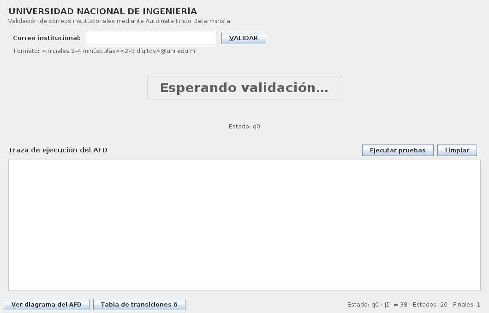
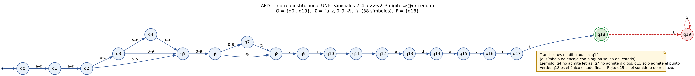
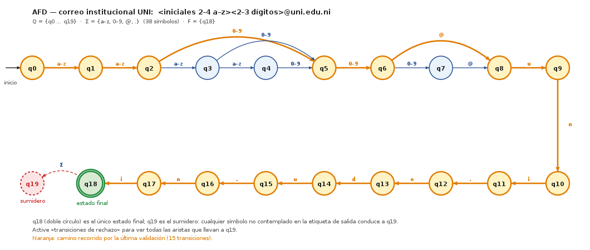
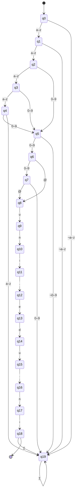

# Validador de Formato de Correo Institucional UNI — AFD (Java + Swing)

Aplicación de escritorio que valida correos institucionales de la **Universidad Nacional de
Ingeniería** con un **Autómata Finito Determinista (AFD) formal** implementado explícitamente en
Java, carácter por carácter, sobre una matriz de transición de `20 × 38`. No se usan expresiones
regulares ni librerías de validación de correo en la ruta de validación.

- **Asignatura / curso:** Teoría de Autómatas y Lenguajes Formales — *(completar)*
- **Autor(es):** *(completar)*
- **Lenguaje:** Java 17 · **GUI:** Swing · **Build:** Maven · **Pruebas:** JUnit 5

| Correo válido | Correo inválido |
|---|---|
| `js25@uni.edu.ni` → **ACEPTADO** | `Js25@unicomp.edu` → **RECHAZADO** |



---

## 1. Objetivo

Automatizar la verificación de los correos institucionales de los estudiantes para la plataforma
virtual, la biblioteca digital y la red interna. La aplicación recibe una cadena, la procesa con el
AFD y muestra:

1. el veredicto **ACEPTADO**/**RECHAZADO** con su alerta modal,
2. el **motivo** del rechazo (tipo, posición y carácter),
3. la **traza de ejecución** completa (`Cadena evaluada`, `Tipo`, `Secuencia de estados`,
   `Resultado`, `¿Esperado?`) en la tabla inferior.

El correo válido tiene la estructura `<iniciales><número>@uni.edu.ni`, con 2–4 letras minúsculas,
2–3 dígitos y el dominio exacto.

---

## 2. Definición formal

```
M = (Q, Σ, δ, q0, F)

Q  = { q0, q1, …, q18, q19 }        (20 estados)
Σ  = { a–z } ∪ { 0–9 } ∪ { @, . }   (38 símbolos)
q0 = q0                             (estado inicial)
F  = { q18 }                        (único estado final)
δ  : Q × Σ → Q                      (función total: 760 transiciones)
```

### 2.1 Estados

| Estado | Significado | ¿Final? |
|---|---|---|
| `q0` | Sin leer caracteres (estado inicial) | No |
| `q1` | 1 letra leída (iniciales incompletas) | No |
| `q2` | 2 letras leídas (iniciales válidas) | No |
| `q3` | 3 letras leídas | No |
| `q4` | 4 letras leídas (límite máximo) | No |
| `q5` | 1 dígito leído (número incompleto) | No |
| `q6` | 2 dígitos leídos (número válido) | No |
| `q7` | 3 dígitos leídos (límite máximo) | No |
| `q8` | `@` | No |
| `q9` | `@u` | No |
| `q10` | `@un` | No |
| `q11` | `@uni` | No |
| `q12` | `@uni.` | No |
| `q13` | `@uni.e` | No |
| `q14` | `@uni.ed` | No |
| `q15` | `@uni.edu` | No |
| `q16` | `@uni.edu.` | No |
| `q17` | `@uni.edu.n` | No |
| `q18` | `@uni.edu.ni` completo | **Sí** |
| `q19` | Trampa / sumidero de rechazo | No |

### 2.2 Función de transición δ

Parte local (por clase de símbolo; `L` = `a–z`, `D` = `0–9`):

| Estado | `L` | `D` | `@` | `.` | otro |
|---|---|---|---|---|---|
| `q0` | `q1` | `q19` | `q19` | `q19` | `q19` |
| `q1` | `q2` | `q19` | `q19` | `q19` | `q19` |
| `q2` | `q3` | `q5` | `q19` | `q19` | `q19` |
| `q3` | `q4` | `q5` | `q19` | `q19` | `q19` |
| `q4` | `q19` | `q5` | `q19` | `q19` | `q19` |
| `q5` | `q19` | `q6` | `q19` | `q19` | `q19` |
| `q6` | `q19` | `q7` | `q8` | `q19` | `q19` |
| `q7` | `q19` | `q19` | `q8` | `q19` | `q19` |

Parte del dominio (por carácter exacto; cualquier otro símbolo va a `q19`):

| Estado | Esperado | Destino |
|---|---|---|
| `q8` | `u` | `q9` |
| `q9` | `n` | `q10` |
| `q10` | `i` | `q11` |
| `q11` | `.` | `q12` |
| `q12` | `e` | `q13` |
| `q13` | `d` | `q14` |
| `q14` | `u` | `q15` |
| `q15` | `.` | `q16` |
| `q16` | `n` | `q17` |
| `q17` | `i` | `q18` |

Estados absorbentes: `δ(q18, s) = q19` y `δ(q19, s) = q19` para todo `s ∈ Σ`.
La tabla completa con el conteo de transiciones por estado está en
[`docs/tabla-transiciones.md`](docs/tabla-transiciones.md).

### 2.3 Invariantes verificados

1. **Determinismo total:** no hay transiciones indefinidas ni ε-transiciones.
2. **Aceptación estricta al final:** se acepta si y solo si el último símbolo consume la cadena y el
   estado alcanzado es `q18`; por eso `js25@uni.edu.ni.mx` se **rechaza** (`Caracteres extra`).
3. **Cadena vacía o nula:** rechazo con tipo `Cadena vacía`, sin excepciones.
4. **Equivalencia:** `L(M) = { w ∈ Σ* | w ∈ [a-z]{2,4}·[0-9]{2,3}·"@uni.edu.ni" }`.

### 2.4 Diagrama de estados (dibujado por el programa)

El diagrama no es una imagen incrustada: la aplicación **lo dibuja en pantalla** con Java2D desde la
matriz δ. Esta imagen la generó el propio renderizador de la aplicación
(`PanelDiagrama.renderizar()`), sin herramientas externas:



El botón **Ver diagrama del AFD** abre una ventana con ese dibujo vectorial, en vivo:

- **Zoom** con `+`, `−` y `100 %`.
- **Resaltar última validación**: pinta en naranja los estados y transiciones recorridos.
- **Transiciones de rechazo**: añade las aristas punteadas que conducen a `q19`.
- **Exportar PNG**: guarda el diagrama tal como se ve.

Con la traza de `js25@uni.edu.ni` resaltada (el camino `q0→q1→q2→q5→q6→q8→…→q18`):



Versión Mermaid (se renderiza en GitHub; las transiciones no dibujadas conducen a `q19`):



El PNG de `docs/` lo produce la propia aplicación (botón **Exportar PNG** de la ventana del
diagrama). La fuente Graphviz se conserva como alternativa formal, por si se desea el dibujo con
`dot`:

```bash
dot -Tpng docs/diagrama-afd.dot -o /tmp/diagrama-graphviz.png
```

---

## 3. Compilación y ejecución

Requisitos: **JDK 17** y **Maven 3.9+**.

```bash
mvn -q clean package          # compila, ejecuta las pruebas y genera target/afd-uni.jar
java -jar target/afd-uni.jar  # abre la ventana de la aplicación
mvn test                      # solo las pruebas (headless, sin entorno gráfico)
```

Pruebas sin pantalla (por ejemplo en un servidor):

```bash
mvn -q test -Djava.awt.headless=true
```

### 3.1 Convertirlo en una aplicación ejecutable

El `pom.xml` ya genera un **jar ejecutable y autocontenido**: `maven-shade-plugin` fija
`Main-Class: ni.edu.uni.afd.Main` y la aplicación no tiene dependencias de ejecución (JUnit es solo
para pruebas), por lo que el jar (~60 KB) funciona con cualquier JRE 17 sin classpath adicional.

| Nivel | Comando | Resultado |
|---|---|---|
| **1. Jar ejecutable** | `mvn -q clean package` | `target/afd-uni.jar` · se ejecuta con `java -jar`, doble clic o un acceso directo |
| **2. Lanzador sin consola** | `./scripts/ejecutar.sh` (Linux/macOS)<br>`scripts\ejecutar.bat` (Windows) | Abre la app con `javaw` (Windows) sin ventana negra de consola |
| **3. App nativa con su propio Java** | `./scripts/empaquetar-nativo.sh` | `target/nativo/AFD-UNI/` con la JVM incluida: **no requiere Java instalado** |
| **4. Instalador** | `./scripts/empaquetar-nativo.sh msi` (Windows)<br>`.sh deb` / `rpm` (Linux)<br>`.sh dmg` (macOS) | Instalador nativo del sistema operativo |

Detalles de cada nivel:

1. **Jar ejecutable.** Es el artefacto principal; también sirve para distribuirlo por correo o
   subirlo a un aula virtual. En Windows, si el doble clic no lo abre, asocie los `.jar` a
   `javaw.exe` o use el lanzador del punto 2. En macOS/Linux: `chmod +x` sobre un script o un
   `.desktop` que llame a `java -jar`.
2. **Lanzador.** `scripts/ejecutar.sh` y `scripts/ejecutar.bat` compilan el jar si aún no existe y
   arrancan la aplicación (`java` en Linux/macOS, `javaw` en Windows para no dejar consola abierta).
   Usan `JAVA_HOME` si está definido y, si no, el `java` del `PATH`; si no encuentran Java, muestran
   un error claro en lugar de fallar en silencio.
3. **App nativa (`jpackage`).** Requiere un **JDK completo 17+** (no un JRE) y genera una carpeta
   `AFD-UNI/` con `bin/AFD-UNI` (o `AFD-UNI.exe`) y su propio runtime recortado. Es la forma más
   profesional de entregar el trabajo: funciona en equipos sin Java.
4. **Instaladores.** `jpackage --type msi`/`exe` en Windows (requiere WiX Toolset), `deb`/`rpm` en
   Linux y `dmg`/`pkg` en macOS. Cada instalador debe generarse **en su propio sistema operativo**:
   `jpackage` no compila de forma cruzada. En macOS y Windows los instaladores deben firmarse para
   evitar avisos del sistema.

Ejemplo manual equivalente al script (Linux/macOS):

```bash
mvn -q clean package
mkdir -p target/jpackage-input && cp target/afd-uni.jar target/jpackage-input/
jpackage --type app-image --name AFD-UNI --app-version 1.0.0 \
         --input target/jpackage-input --main-jar afd-uni.jar \
         --main-class ni.edu.uni.afd.Main \
         --java-options "-Dfile.encoding=UTF-8" --dest target/nativo
```

Para poner un icono propio: `export ICONO=ruta/icono.png` antes de ejecutar el script (`.ico` en
Windows, `.icns` en macOS).

> **Alternativa para Windows:** [Launch4j](https://launch4j.sourceforge.net/) envuelve el jar en un
> `.exe` con icono e incluso puede incrustar una JRE. `jpackage` cubre el mismo caso sin herramientas
> adicionales, por eso es la opción documentada.

### 3.2 Problemas frecuentes con el jar

| Síntoma | Causa | Solución |
|---|---|---|
| **Ejecutar pruebas** avisa de que no hay casos, o el botón parece no responder | El jar no contiene `casos-prueba.csv` (típico de un jar exportado desde el IDE sin la carpeta de recursos) | La aplicación ya cae en el **banco integrado**, ejecuta los 22 casos y lo advierte en el resumen («se usó el banco integrado»). Para recuperar el archivo: `jar tf target/afd-uni.jar \| grep casos-prueba.csv`; si falta, generar el paquete con `mvn -q clean package` |
| Aparece un diálogo con una excepción al pulsar el botón | Fallo inesperado dentro de la batería | El diálogo muestra la clase y el mensaje de la excepción; con esa información se localiza el problema (antes el error solo se escribía en una consola inexistente) |
| `no main manifest attribute, in afd-uni.jar` | Se está abriendo el jar original que deja *shade* | Ejecutar `target/afd-uni.jar`, no `target/original-afd-uni.jar` |
| `UnsupportedClassVersionError` | La JVM es anterior a Java 17 | Instalar un JRE 17 o entregar la app nativa de `jpackage`, que incluye su propia máquina virtual |
| El doble clic en Windows no abre nada | Asociación de archivos `.jar` ausente o rota | Usar `scripts\ejecutar.bat`, que llama a `javaw -jar`, o asociar los `.jar` a `javaw.exe` |
| Los acentos y el símbolo `Σ` se ven mal | Consola con codificación distinta de UTF-8 | Añadir `-Dfile.encoding=UTF-8` (los lanzadores del proyecto ya lo hacen) |

---

## 4. La interfaz

```
┌───────────────────────────────────────────────────────────────────────────┐
│ UNIVERSIDAD NACIONAL DE INGENIERÍA                                        │
│ Validación de correos institucionales mediante Autómata Finito Determin.   │
│ Correo institucional: [ js25@uni.edu.ni            ]  [ VALIDAR ]          │
│ Formato: <iniciales 2–4 minúsculas><2–3 dígitos>@uni.edu.ni                │
│                          ┌──────────────────┐                             │
│                          │     ACEPTADO     │  ← verde #1B8A3A            │
│                          └──────────────────┘                             │
│              Estado final: q18 · cadena consumida en 15 transiciones      │
├───────────────────────────────────────────────────────────────────────────┤
│ Traza de ejecución del AFD           [Ejecutar pruebas] [Limpiar]         │
│ # │ Cadena evaluada   │ Tipo      │ Secuencia de estados      │ Resultado │ ¿Esperado? │
│ 1 │ js25@uni.edu.ni   │ Válido    │ q0→q1→q2→…→q18            │ Aceptado  │ Sí         │
│ 2 │ Js25@unicomp.edu  │ Símbolo…  │ q0→q19 (corte)            │ Rechazado │ No         │
├───────────────────────────────────────────────────────────────────────────┤
│ [Ver diagrama del AFD] [Tabla de transiciones δ]   Estado: q0 · |Σ| = 38  │
└───────────────────────────────────────────────────────────────────────────┘
```

### 4.1 Comportamiento

| Elemento | Comportamiento |
|---|---|
| Campo de correo | 420 px, monoespaciado 16 pt, límite 64 caracteres, `selectAll()` al recibir foco |
| Botón **VALIDAR** | Acción por defecto de la ventana: **Enter** también valida; atajo `Alt+V` |
| Etiqueta de veredicto | `ACEPTADO` en verde / `RECHAZADO` en rojo; gris “Esperando validación…” antes de validar |
| Etiqueta de detalle | `Estado final: q18 …` o `Fallo en la posición 0 ('J') — símbolo no permitido · estado q19` |
| Alerta modal | `JOptionPane` informativa si se acepta, de advertencia si se rechaza; aparece **después** de actualizar la tabla |
| **Ejecutar pruebas** | Limpia la tabla, valida los 22 casos de `casos-prueba.csv` y resume `n/n casos esperados correctos`. Si el recurso no está en el paquete, usa el banco integrado de respaldo |
| **Limpiar** | Vacía tabla, campo, veredicto y detalle; devuelve el foco al campo |
| **Ver diagrama del AFD** | Ventana no modal que **dibuja el autómata en pantalla** (Java2D): zoom, resaltado de la traza en vivo, transiciones de rechazo y exportación a PNG |
| **Tabla de transiciones δ** | `JDialog` con la matriz agrupada por clases (20 filas), con nota explicativa |
| Barra de estado | `Estado: q0 · |Σ| = 38 · Estados: 20 · Finales: 1` |
| División vertical | `JSplitPane` 40/60 entre validación y traza |

### 4.2 Columnas de la tabla de traza

| Columna | Contenido |
|---|---|
| `#` | Consecutivo de la evaluación (se reinicia con **Limpiar**) |
| `Cadena evaluada` | Cadena tal como se ingresó (`«vacía»` si está vacía, `«nula»` si la entrada fue `null`) |
| `Tipo` | `Válido`, `Cadena vacía`, `Símbolo no permitido`, `Iniciales inválidas`, `Dígitos inválidos`, `Dominio inválido`, `Caracteres extra` |
| `Secuencia de estados` | Camino completo, monoespaciado; `(corte)` cuando la cadena no se consumió por completo |
| `Resultado` | `Aceptado` (verde) o `Rechazado` (rojo) |
| `¿Esperado?` | `Sí` / `No` si la cadena pertenece al banco de casos, `—` si no |

La ayuda emergente de cada fila muestra el motivo del veredicto y la secuencia completa.
La columna `#` admite ordenamiento (`RowSorter`); las filas no son editables.

> Nota sobre `(corte)`: la marca es texto plano para no depender de fuentes con símbolos o emoji;
> indica que la cadena dejó de consumirse porque el autómata cayó en `q19`.

---

## 5. Estructura del proyecto

```
afd-uni/
├─ pom.xml
├─ README.md
├─ scripts/
│  ├─ ejecutar.sh                  # lanza la app desde el jar (compila si falta)
│  ├─ ejecutar.bat                 # ídem en Windows, sin consola (javaw)
│  └─ empaquetar-nativo.sh         # app nativa e instaladores con jpackage
├─ docs/
│  ├─ diagrama-afd.dot            # fuente Graphviz
│  ├─ diagrama-afd.png            # diagrama generado por la propia aplicación
│  ├─ diagrama-traza.png          # el mismo dibujo con la traza resaltada
│  ├─ captura-interfaz.png        # interfaz en su estado inicial
│  ├─ captura-aceptado.png        # validación exitosa (figura B.1 del informe)
│  ├─ captura-rechazado.png       # validación rechazada (figura B.2 del informe)
│  ├─ captura-bateria.png         # ejecución de la batería de 22 casos
│  └─ tabla-transiciones.md       # δ completa y conteo de transiciones
└─ src/
   ├─ main/java/ni/edu/uni/afd/
   │  ├─ Main.java                       # punto de entrada, EDT y Look & Feel
   │  ├─ modelo/
   │  │  ├─ Alfabeto.java                # Σ, índice de símbolo, clasificación de caracteres
   │  │  ├─ Estado.java                  # enum q0…q19, esFinal(), esSumidero(), etiqueta()
   │  │  ├─ Delta.java                   # matriz explícita Estado[20][38] + tabla agrupada
   │  │  ├─ Automata.java                # validar(String) → ResultadoValidacion
   │  │  ├─ ResultadoValidacion.java     # record con veredicto, traza y motivo
   │  │  ├─ Paso.java                    # record: un paso δ(q, s) = q'
   │  │  ├─ TipoResultado.java           # enum de clasificación del resultado
   │  │  ├─ CasoPrueba.java              # record de un caso del banco
   │  │  └─ BancoCasos.java              # carga casos-prueba.csv + banco integrado de respaldo
   │  ├─ vista/
   │  │  ├─ VentanaPrincipal.java
   │  │  ├─ PanelValidacion.java
   │  │  ├─ PanelTraza.java
   │  │  ├─ TrazaTableModel.java
   │  │  ├─ PanelDiagrama.java           # dibuja el AFD con Java2D (estados y etiquetas)
   │  │  ├─ DialogoDiagrama.java         # ventana del diagrama: zoom, resaltado, exportar
   │  │  └─ DialogoTablaDelta.java
   │  └─ controlador/
   │     └─ ControladorValidador.java    # conecta vista ↔ autómata
   ├─ main/resources/
   │  └─ casos-prueba.csv                # 22 casos con veredicto y descripción
   └─ test/java/ni/edu/uni/afd/
      ├─ AutomataTest.java               # 39 invocaciones JUnit 5 sobre el autómata
      ├─ BancoCasosTest.java             # 3 pruebas del banco de casos y de la batería
      └─ PanelDiagramaTest.java          # 5 pruebas del dibujo del diagrama
```

---

## 6. Pruebas

`AutomataTest` (JUnit 5) cubre:

1. 4 correos válidos parametrizados (incluidos los límites 2/2 y 4/3).
2. 21 correos inválidos parametrizados con el `TipoResultado` esperado.
3. Cadena vacía y cadena nula sin excepciones.
4. Totalidad y determinismo de δ (20 × 38 celdas no nulas) y absorción de `q18`/`q19`.
5. Todo símbolo fuera de Σ (mayúsculas, espacios, `-`, `_`, `+`, `#`, acentos, saltos de línea) cae
   en `q19` en la posición correcta.
6. Aceptación estricta al final (`js25@uni.edu.ni.` y `js25@uni.edu.niX` se rechazan).
7. Longitud de la secuencia (`|cadena| + 1`) y traza exacta de `js25@uni.edu.ni`.
8. Verificación cruzada contra `^[a-z]{2,4}[0-9]{2,3}@uni\.edu\.ni$` en **2000 cadenas aleatorias**.
9. Consistencia del banco `casos-prueba.csv` y dimensiones de la tabla agrupada.
10. Determinismo: dos ejecuciones producen el mismo resultado.

`PanelDiagramaTest` (JUnit 5) verifica el dibujo: renderizado sin pantalla, las 22 transiciones
etiquetadas, el resaltado de trazas aceptadas y rechazadas, el dibujo de las transiciones de rechazo y
los límites del zoom.

`BancoCasosTest` (JUnit 5) verifica el banco de casos que consume el botón **Ejecutar pruebas**: que
el banco integrado coincida caso por caso con `casos-prueba.csv`, que sus 22 casos produzcan el
veredicto esperado y que la batería llene la tabla de traza **sin entorno gráfico**.

Resultado de la última ejecución: **47 de 47 invocaciones correctas** (39 del autómata + 5 del dibujo
+ 3 del banco de casos).

### 6.1 Batería mínima de casos

| # | Cadena | Esperado | Tipo | ✔ |
|---|---|---|---|---|
| 1 | `js25@uni.edu.ni` | ACEPTADO | Válido | ✔ |
| 2 | `lmra123@uni.edu.ni` | ACEPTADO | Válido | ✔ |
| 3 | `ab12@uni.edu.ni` | ACEPTADO | Válido | ✔ |
| 4 | `Js25@unicomp.edu` | RECHAZADO | Símbolo no permitido | ✔ |
| 5 | `j@unicomp.edu` | RECHAZADO | Iniciales inválidas | ✔ |
| 6 | `js25@unicom.edu` | RECHAZADO | Dominio inválido | ✔ |
| 7 | `abc123@gmail.com` | RECHAZADO | Dominio inválido | ✔ |
| 8 | `js2@uni.edu.ni` | RECHAZADO | Dígitos inválidos | ✔ |
| 9 | `js2500@uni.edu.ni` | RECHAZADO | Dígitos inválidos | ✔ |
| 10 | `a12@uni.edu.ni` | RECHAZADO | Iniciales inválidas | ✔ |
| 11 | `abcde12@uni.edu.ni` | RECHAZADO | Iniciales inválidas | ✔ |
| 12 | `js25@uni.edu.ni.mx` | RECHAZADO | Caracteres extra | ✔ |
| 13 | `js25uni.edu.ni` | RECHAZADO | Dígitos inválidos | ✔ |
| 14 | `js25@uni.edu.ni ` | RECHAZADO | Símbolo no permitido | ✔ |
| 15 | *(cadena vacía)* | RECHAZADO | Cadena vacía | ✔ |

---

## 7. Decisiones de diseño y supuestos

1. **Corrección del alfabeto.** El enunciado listaba de nuevo `e, d, u, n, i, c, o, m, p` dentro de Σ y
   omitía la llave de cierre. Esas letras ya pertenecen a `a–z`, de modo que el alfabeto correcto es
   `Σ = {a–z} ∪ {0–9} ∪ {@, .}`, con `|Σ| = 38`.
2. **q19 como sumidero.** Garantiza que δ sea una **función total**: todas las celdas de la matriz
   tienen destino, no hay transiciones indefinidas y el rechazo es inmediato e irreversible.
3. **Sin normalización de la entrada.** No se recorta ni se pasa a minúsculas: `" js25@uni.edu.ni"`,
   `"js25@uni.edu.ni "` y `"js25@uni.edu.ni\n"` se rechazan como `Símbolo no permitido`, porque el
   espacio no pertenece a Σ. El campo de la GUI tampoco modifica el texto.
4. **Clasificación derivada del estado de origen.** El `TipoResultado` se calcula con
   `TipoResultado.desdeFallo(estadoOrigen, símbolo)`, no con heurísticas sobre la cadena completa.
5. **Contradicción resuelta (regla más estricta).** El enunciado pedía clasificar `js25@uni.edu.niX`
   como `Caracteres extra`, pero `'X'` no pertenece a Σ. Se aplica la regla de conjuntos: un carácter
   fuera de Σ siempre es `Símbolo no permitido`; `Caracteres extra` se reserva para símbolos **de Σ**
   leídos después de `q18` (`js25@uni.edu.ni.`, `js25@uni.edu.ni1`, `js25@uni.edu.ni.mx`).
6. **Sin expresiones regulares en la validación.** La referencia con `Pattern` aparece únicamente en
   las pruebas, como verificación cruzada.
7. **Clases añadidas a la estructura sugerida:** `CasoPrueba` y `BancoCasos` (necesarias para leer
   `casos-prueba.csv` y responder la columna `¿Esperado?`), `TrazaTableModel` (mencionado en el diseño
   de la tabla) y `PanelDiagrama` (dibuja el autómata con Java2D). No se incrusta ninguna imagen como
   recurso: el diagrama se dibuja en tiempo de ejecución.
8. **El dominio `@uni.edu.ni`** aparece en el código solo en constantes de mensajes y documentación;
   la validación se hace exclusivamente con la matriz δ.
9. **Banco de casos con respaldo integrado.** `casos-prueba.csv` sigue siendo la fuente editable,
   pero el programa lleva en el código una copia de los 22 mismos casos (`BancoCasos.incluido()`) que
   se usa si el recurso no viaja en el paquete. La prueba `BancoCasosTest` compara ambas fuentes, de
   modo que cualquier divergencia rompe la compilación. Así el botón «Ejecutar pruebas» funciona
   incluso en un jar exportado sin la carpeta de recursos.
10. **Errores visibles, nunca silenciosos.** La batería de pruebas se ejecuta dentro de un `try` y,
    si algo falla, se muestra un diálogo con la clase y el mensaje de la excepción: al abrir el jar
    con `javaw` no hay consola donde leer la traza.
9. **El diagrama se dibuja con Java2D, no se incrusta una imagen.** `PanelDiagrama` calcula la
   geometría de los 20 estados (dos filas en serpentina), traza las 22 aristas con sus etiquetas y
   pinta resaltados; así el dibujo es vectorial, se adapta al zoom y se mantiene sincronizado con la
   última validación. `docs/diagrama-afd.dot` se conserva como fuente Graphviz alternativa.

---

## 8. Verificación realizada

| Comprobación | Resultado |
|---|---|
| Compilación de las 18 clases de producción con `-Xlint:all` | 0 errores, 0 advertencias |
| Batería `AutomataTest` (39 invocaciones, incluidas 2 000 cadenas aleatorias) | 39/39 correctas |
| Batería `PanelDiagramaTest` (5 pruebas del dibujo) | 5/5 correctas |
| Batería `BancoCasosTest` (3 pruebas del banco de casos) | 3/3 correctas |
| Botón «Ejecutar pruebas» en un jar **sin** el recurso `casos-prueba.csv` | 22/22 con el banco integrado |
| Consistencia de `casos-prueba.csv` (22 casos) | 22/22 correctos |
| Composición de `PanelValidacion` y `PanelTraza` y capturas de la interfaz | correctas (`docs/captura-*.png`) |
| Dibujo del diagrama por la aplicación (PNG sin y con traza) | correcto (`docs/diagrama-afd.png`, `docs/diagrama-traza.png`) |
| Fuente Graphviz alternativa `.dot` | válida (se puede compilar con `dot -Tpng`) |

> Nota de transparencia: el entorno donde se generó este proyecto no tenía acceso a Maven Central, por
> lo que `mvn package` no se ejecutó allí. La compilación se verificó con el compilador de Eclipse
> (`ecj 3.38`) apuntando a Java 17 y las pruebas se ejecutaron con un arnés equivalente sobre la misma
> clase `AutomataTest`. El `pom.xml` es estándar y está listo para `mvn -q clean package` en un equipo
> con Maven.

---

## 9. Limitaciones y trabajo futuro

- No verifica la existencia real del buzón (DNS/SMTP) ni el envío de correo.
- No admite mayúsculas, Unicode, `+`, `_`, subdominios ni alias: el alfabeto es deliberadamente
  estricto.
- La ventana no guarda historial entre sesiones; la traza vive en memoria.
- Mejoras posibles: exportar la traza a CSV/PDF, resaltar el carácter del fallo dentro del campo,
  modo oscuro, internacionalización y una vista paso a paso de la animación del autómata.
